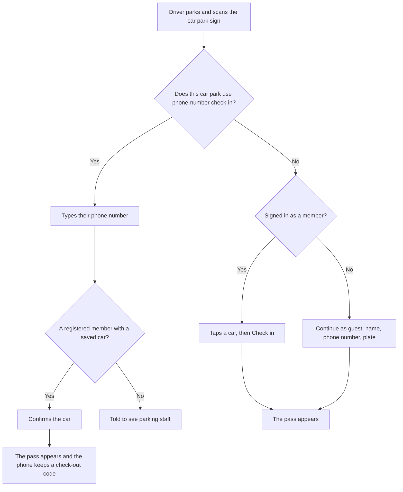
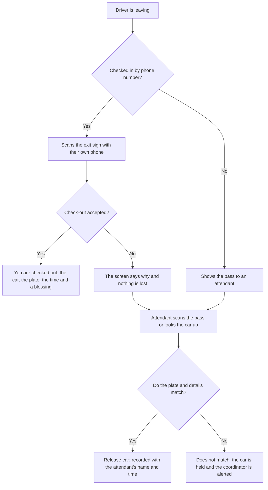
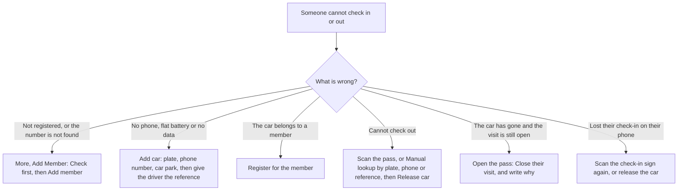

# Church Parking

A digital replacement for paper parking tallies at church. Drivers check in on their phone and keep a digital pass; the parking team checks the pass against the real car at the exit.

Live at **https://churchparking.online** (used by Celebration Church).

- **Drivers** open the site and tap **Check in** (then choose their car park) or **Scan a car park sign**, then register their car and get a pass. Members have an account, so they check in with two taps.
- **Phone-number check-in** (built, switched on per car park): scanning a sign opens a page with just a phone number field. The member confirms their registered car and gets a pass, and scanning the **exit sign** later checks them out with no typing. It is off on the live site until the rollout steps are done ([docs/qr-rollout.md](docs/qr-rollout.md)).
- **Attendants** scan the pass at the exit, check that the plate matches the car, and release it. With no pass, they look the car up by plate, phone or reference.
- **Coordinators** (team leads) watch live counts for each car park and service, deal with alerts, correct mistakes and sweep the car parks after each service.
- **Admins** manage services, car parks, QR signs, staff and members (create, edit, delete one or many, always after a confirmation), and read visits, reports and analytics.

## Status

Built and in use. Everything in [docs/roadmap.md](docs/roadmap.md) is done except the real-phone checklists ([docs/field-test.md](docs/field-test.md) and the one in [docs/qr-rollout.md](docs/qr-rollout.md)), which need doing on real phones in a real car park. The phone-number check-in and exit sign are built and tested but off on the live server; turning it on needs the live-data check first. Remaining decisions and ideas are listed at the end of the roadmap.

## Screens

| Address | What it is | For |
|---|---|---|
| `/` | Home: Check in, Scan a car park sign, member sign-in | Everyone |
| `/c` | "Where are you parking?" The list of car parks | Drivers |
| `/scan` | Scan a car park sign with the camera | Drivers |
| `/c/<car park>` | Check-in for one car park (the same page its QR sign opens). With phone-number check-in on, only a phone number field | Drivers |
| `/c/<car park>/out` | The exit sign: scanning it checks out the phone that checked in there | Drivers |
| `/p/<token>` | The pass | Driver; staff see more |
| `/account/*` | Member sign-up, sign-in, cars and history | Members |
| `/staff` | Team home, scanner, search, register, history, service info | Attendants and up |
| `/staff/dashboard`, `/staff/sweep` | Live Parking (counts, cars parked now, alerts) and the end-of-service sweep | Coordinators and up |
| `/admin/*` | Dashboard, Visits, Vehicles, Users (members and staff accounts), Reports, Analytics, Settings (General, Services, Parking areas, QR signs, Vehicle rules, Users & access, Notifications, System) | Admins (Visits also for coordinators) |

## How it works: every flow

Who does what, step by step. The product spec ([docs/spec.md](docs/spec.md)) has the requirements behind each flow, and the guides ([attendant](docs/attendant-guide.md), [admin](docs/admin-guide.md), [phone check-in rollout](docs/qr-rollout.md)) have the screens.

### 1. A driver arrives

Every car park has a QR sign. Scanning it opens that car park's check-in page. What the driver sees depends on whether the car park uses **phone-number check-in** (switched on car park by car park by the server's `QR_SESSION_FLOW` setting, see [docs/qr-rollout.md](docs/qr-rollout.md)).



**Original check-in (car parks not on phone check-in)**

- **Member (two taps):** sign in with phone number and PIN (once; the phone stays signed in for 180 days), scan the sign, tap a saved car, tap **Check in**. The pass appears. A member can save several cars and add the app to their home screen.
- **Guest (under a minute):** scan the sign, tap **Continue as guest**, enter name, phone number and plate, tap **Get my pass**. The pass appears, with an offer to turn the details into a member account by choosing a PIN.
- **The service is picked for them** (the next one starting within 30 minutes, otherwise the one in progress, otherwise the next that day), and the car park comes from the sign.
- **Safe repeats:** scanning again, or reloading, never makes a second visit. A phone that already has a live pass is offered it first.
- **Blocked check-ins:** a car already checked in, or a plate saved to a member's account, cannot be checked in as a guest. The driver is told to see an attendant, and the coordinator gets an alert (first claim on a plate each day wins).

**Phone-number check-in (car parks switched on)**

1. The member types their phone number (for example 0803 123 4567). Nothing is created yet.
2. The app shows the car (or cars) saved to that number. The member confirms the one they are parking.
3. The visit is made, the pass is shown, and the phone is given a **check-out code** that only that phone holds.
4. A number that is not an active member with an active car gets one answer, "please see parking staff". A member already checked in at another car park is told to check out there first. When no service is open, the page says so.
5. Numbers are rate limited per phone and per address, so nobody can guess their way through.

**The pass.** A QR code and a short reference such as `PK-7Q4M`. It reopens on the phone (or member account) that made it until the car is released, works only on the service date it was issued (Lagos time), and anyone else who opens the link sees only the plate and its status.

### 2. A driver leaves



- **Exit sign (phone check-in only):** scan the exit sign at the car park the member checked in at. The check-out is sent once, with no typing, and success is shown only after the server confirms it. If it cannot be done the screen says why: already checked out, no check-in found on this phone (scan the check-in sign again to bring it back), expired, a different car park, car on hold, no connection (try again, it is safe), or too many tries.
- **Attendant at the exit:** the original way, and always available, including for members who check in by phone. Whichever of the two ends the visit first wins; the other is told the car is already out.
- **At midnight (Lagos time)** every visit still open is closed as *missed* (a car that left without being scanned).

### 3. The attendant's job

Sign in at `/staff` with phone number and password (12-hour session), and choose the car park you are standing at. The app remembers it for your shift.

**Release a car**

1. Tap **Scan pass** and point the camera at the pass. The plate appears in large type with the car park, the service and the driver's first name.
2. Look at the car. Does the plate on the screen match the plate on the car?
3. A card marked **GUEST** or **NEW CAR**: ask the driver for their name and phone number (do not read them out first) and check the first name and the last four digits.
4. Everything matches: **Release car**. Anything does not match: **Does not match**, stay with the car, call the coordinator. Only a coordinator can clear the hold, and they must give a reason.

| The screen says | What to do |
|---|---|
| **ALREADY RELEASED** | Do not release. Tell the coordinator, as someone may be using an old pass. |
| **OLD PASS** | The pass is from another day. Do not release. Look the car up by plate. |
| **ON HOLD** | A coordinator must clear it. Stay with the car. |
| **Invalid pass** | Scan again. If it still fails, look the car up by plate. |
| **A different car park** | A yellow warning names both car parks. Check the car, and if it is the right car and still here, tap **Move to this car park**, then release it. |
| **The member checked out with the exit sign** | Do not release again. |

**When someone cannot check in or out**



- **Manual lookup** finds a car by plate, phone number or reference. The screen shows the registered name and the last four digits; ask the driver for theirs without reading them out first. A release made this way is recorded as a lookup, not a scan.
- **Add car** registers a car by hand for a visit (plate and phone number, name optional, pick the car park) and gives the driver the reference.
- **Add Member** (under **More**) registers a member so they can check in by phone: type their number or plate and tap **Check** (so nobody is added twice), then enter name, Nigerian phone number and plate. A number or plate that already belongs to a member is refused, and your name is recorded.
- **Recent scans** lists today's entries and exits, newest first, and opens a car. **Service info** shows today's services (Active, Next or Finished) and the car parks, so you know which service is running.
- **Phone numbers** are shown as the last four digits. Tapping **Show number** is recorded.

### 4. The coordinator's job

Everything an attendant can do, plus:

- **Live Parking (`/staff/dashboard`)** shows, for the chosen service, the cars checked in, cars left and cars still parked in each car park, the cars parked right now (longest first, with an overstaying flag), and the alerts. It refreshes every few seconds without reloading.
- **Alerts** (a car held with **Does not match**, a blocked second check-in, a plate claimed under a member, a missed check-out) appear straight away. **Investigate** opens the visit; **Mark as dealt with** clears it.
- **Clearing a hold** needs a reason and is logged.
- **Corrections** (change a car's car park or service, undo a release, close a visit) each need a reason and are logged with who made them.
- **End-of-service sweep (`/staff/sweep`):** about 30 minutes after a service ends, list the cars still recorded as parked. Mark each **Still here** (the visit carries over to the next service) or **Gone** (one car at a time, with a confirmation; it becomes *missed*, never a release). A car recorded as parked 30 or more minutes after its service ended is flagged as overstaying. The sweep history lists what was recorded.
- **Visits** lists every visit by day, with filters, and a flag on any visit open 12 hours or more.

### 5. The admin's job

Everything a coordinator can do, plus the screens under `/admin`:

- **Dashboard, Analytics and Visits:** counts for the day or period, charts, and every visit with filters.
- **Users:** members and staff accounts together. Add, edit, switch off or on, set a member's PIN or a staff password, and delete one or many, always after a confirmation. A staff account with activity on record cannot be deleted (switch it off instead), and a deleted member's visits stay in the records as "Deleted member".
- **Vehicles:** every vehicle, who owns it, and its status.
- **Settings:** church details, **Services** (the schedule that decides which service a driver is put in), **Parking areas** (add, rename, switch off, delete when never used), **QR signs** (print the A4 check-in sign and the **exit sign** for each car park), vehicle rules, users and access, notifications, and system information.
- **Reports:** choose dates and a service, then download one report as a CSV, **everything in one Excel workbook**, or a **designed PDF report** with charts. Every download is logged, and none contains names or phone numbers.
- **Results appear as toasts** (saved, error, notice), and every change is written to the audit log.

### 6. A member's account

Sign up or sign in with phone number and PIN (a wrong PIN locks the account for a while; an administrator can unlock it). **My vehicles** adds, edits and removes cars. **Parking history** lists real visits, newest first, and a visit that is still open opens its pass. A member can change their PIN and delete their account at any time; their visits stay in the records as "Deleted member".

### 7. If the app stops working

Tell the coordinator at once. Use paper tallies for the rest of that service (plate and phone number, matched at the exit as before), and the coordinator writes down when the app stopped and when it came back. Cars checked in on the app before it stopped can still be released once it is back; paper-tally cars are not in the app.

### The rules behind the flows

- A car can have only one open visit at a time, and a member only one open visit.
- The first claim on a plate each day wins; a guest cannot use a plate saved to a member.
- Only staff can release a car, and release is atomic: if two attendants try at once, only the first works.
- Every action that changes a visit writes an audit row in the same database transaction.
- Staff see only the last four digits of a phone number unless they tap **Show number**; admins see full numbers in the Members list.
- Names, phone numbers and the check-out code are never put in addresses, QR codes or logs.
- Member visits and the audit log are kept forever; guest records are deleted after 24 months.

## Tech

- Next.js (App Router), TypeScript in strict mode, Tailwind CSS v4
- PostgreSQL through PostgREST (a hosted Supabase project for development and tests; the church's own server for production, see [docs/architecture.md](docs/architecture.md))
- Custom sessions: members sign in with phone and PIN, staff with phone and password
- `zod` for every server input, `html5-qrcode` to scan, `qrcode` to draw QR codes
- Vitest for unit tests, Playwright for end-to-end tests, axe for accessibility

## Running it locally

You need Node 20 or newer and pnpm.

```bash
pnpm install
cp .env.example .env.local     # then fill in the values (see below)
pnpm dev                       # http://localhost:3000
```

`.env.local` needs `APP_URL`, `SUPABASE_URL`, `SUPABASE_SERVICE_ROLE_KEY`, `SESSION_SECRET` (a long random string), and `ADMIN_PHONE` and `ADMIN_PASSWORD` for the first admin (`pnpm db:seed-admin`). Use a throwaway Supabase project and apply the files in `supabase/migrations/` in order. Never commit `.env.local`.

To try phone-number check-in, add `QR_SESSION_FLOW=on` (or `pilot` with `QR_SESSION_AREAS=road`). Left unset it is off and every car park uses the original check-in.

**Trying it on a phone.** With the laptop and phone on the same Wi-Fi, open `http://<the laptop's address>:3000` (the `Network:` line `pnpm dev` prints). The QR scanner needs https, so for that use `pnpm dev:https`.

On a weekday there is no service, so check-in is closed. `pnpm dev:test-service on` opens an all-day test service in the dev database (and `off` hides it again).

## Commands

```bash
pnpm dev                       # development server
pnpm build && pnpm start       # production build
pnpm test                      # unit tests (Vitest)
pnpm test:e2e                  # end-to-end tests (Playwright, phone-sized browser)
pnpm test:integration          # database tests (hosted dev project only)
pnpm test:perf                 # slow-network and 300-check-in load tests
pnpm lint
pnpm typecheck
pnpm db:seed-admin             # create or update the first admin from .env.local
pnpm dev:test-service on|off   # dev only: all-day service so check-in works on a weekday
```

The end-to-end tests run against the development database and a real browser on their own port (3457). Stop any other dev server first, and run the large suites one file at a time (`pnpm exec playwright test <file>.spec.ts`).

## Docs

| File | What's in it |
|---|---|
| [docs/spec.md](docs/spec.md) | Product spec: roles, flows, requirements and business rules |
| [docs/decisions.md](docs/decisions.md) | Decisions made, with reasons (D-01 to D-43). Later decisions change the spec where they differ. |
| [docs/architecture.md](docs/architecture.md) | How the app is put together: folders, data access, rules, check-in, passes, scanning, testing |
| [docs/security.md](docs/security.md) | Threat model and the security rules |
| [docs/data-model.md](docs/data-model.md) | Database schema and later additions |
| [docs/roadmap.md](docs/roadmap.md) | Milestones, what is done, and what is next |
| [docs/attendant-guide.md](docs/attendant-guide.md) | One-page guide for the parking team at the exit |
| [docs/admin-guide.md](docs/admin-guide.md) | What each admin screen is for |
| [docs/field-test.md](docs/field-test.md) | The real-phone checklist |
| [docs/qr-rollout.md](docs/qr-rollout.md) | Phone-number check-in and the exit sign: what it does, the steps before it goes live, how to turn it on and off |
| [docs/GAP_ANALYSIS.md](docs/GAP_ANALYSIS.md) | How the phone-number check-in was built against the refactor documents, what differs, and what is not yet verified |
| [docs/church-parking-refactor-docs/](docs/church-parking-refactor-docs/) | The requirements, architecture and plan for the phone-number check-in |
| [docs/audit/](docs/audit/) | The application audit and its findings |
| [CLAUDE.md](CLAUDE.md) | Working instructions for Claude Code |

## Privacy and security in one paragraph

Drivers give a name, phone number and plate. Attendants and coordinators see only the last four digits of a phone number unless they tap **Show number**, which is logged; admins see full numbers in the Members list and on member pages, while a visit's driver number stays masked until **Show number**. Names and numbers never appear in URLs, QR codes or logs, and the check-out code that lets a phone check out is never logged or put in an address. Member visits and the audit log are kept forever; guest records are deleted after 24 months. A service, car park or staff account with history cannot be deleted, so past records always keep what they point to. See [docs/security.md](docs/security.md) for the rules and [docs/decisions.md](docs/decisions.md) for why.

## Licence

MIT. See [LICENSE](LICENSE). The church's name, logo and design images are not covered by the licence.
